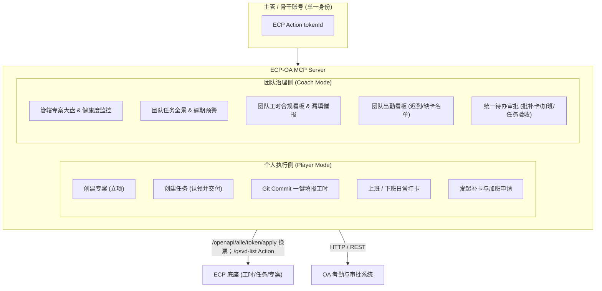

# ECP-OA MCP Server

基于 **Model Context Protocol (MCP)** 规范构建的企业效能与协同中枢服务，无缝打通 **ECP（企业中台 / AIPower / Quicksilver）** 与 **企业 OA 考勤系统**。

专为**“业务骨干兼团队管理者（Player-Coach / 运动员兼教练员）”**角色设计，支持个人日常产出执行与团队高效治理协同。

---

## 🌟 核心特性与双模架构

系统采用**“个人执行（Maker）与团队管理（Manager）”双轮驱动矩阵**，同一套主管账号身份无缝切换：



---

## 🛠️ MCP 工具清单 (Tools)

### 1. 工时管理 (Timesheet Tools)
* **`ecp_get_timereport_dashboard`**：获取个人指定日期的工时填报看板（目标工时、已填工时、明细与可选任务）。
* **`ecp_submit_timesheet`**：手工提交个人工时明细到 ECP 系统（支持初次填报与同日追加）。
* **`ecp_update_timesheet_detail`**：修改指定的一条工时明细（调整任务、工时数、描述等）。
* **`ecp_delete_timesheet_detail`**：删除指定的工时明细条目并自动重新计算当日工时。
* **`ecp_auto_fill_timesheet_from_git`**：【一键填工时】扫描本地 Git 仓库当日 commits，智能生成工作描述并提交至 ECP。
* **`ecp_get_team_timesheet_summary`**：【主管管理】获取管辖团队或专案成员在指定日期的工时合规大盘（未填/少填名单）。
* **`ecp_remind_missing_timesheet`**：【主管管理】对未填或少填工时的成员发送系统工时催报通知。

### 2. 专案管理 (Project Tools)
* **`ecp_create_project`**：创建新专案，默认将专案经理（PM）指定为您本人。
* **`ecp_list_my_managed_projects`**：【主管管理】查询我负责或管理的专案大盘（进度率、健康度、延期状态）。
* **`ecp_get_project_health`**：【主管管理】深度获取专案健康度、预算工时消耗比例与里程碑达成情况。

### 3. 任务管理 (Task Tools)
* **`ecp_create_task`**：创建新任务，支持指派给自己或分派给团队成员。
* **`ecp_update_my_task`**：更新个人名下任务进度与描述，或提交完结验收。
* **`ecp_list_my_tasks`**：查询分配给当前用户的任务列表。
* **`ecp_list_team_tasks`**：【主管管理】查询团队全部任务，或管辖专案下的执行任务全景。
* **`ecp_audit_task_finish`**：【主管管理】根据任务 ID 联动底层工作项验收下属申请完结的任务，通过归档，驳回打回修改。

### 4. 统一流程审核 (Unified Approval Tools)
* **`oa_list_pending_approvals`**：【主管管理】获取待我审批的流程工作项单据池（基于 Quicksilver 底座 WorkItem 引擎）。
* **`oa_audit_action`**：【主管管理】对指定的工作项审批单据执行通过或驳回。
* **`oa_batch_audit`**：【主管管理】批量快速审批通过选定的待办工作项。

### 5. 企业公告管理 (Proclamation / Announcement Tools)
* **`ecp_list_announcements`**：查询企业或部门发布的最新公告列表。
* **`ecp_publish_announcement`**：【主管发布】发布新的企业或团队通知公告。

> **注**：考勤打卡（上下班打卡/补卡/加班申请）已从核心流程中解耦隔离，聚焦于纯粹的工时、任务、专案、审批与公告闭环。

---

## 📦 MCP 上下文资源 (Resources)

* **`ecp://timereport/today`**：今日个人工时填报达成情况与明细快照。
* **`ecp://tasks/my-pending`**：当前用户负责的进行中任务列表。
* **`oa://approvals/pending`**：当前待审批工作项池快照。
* **`ecp://announcements/latest`**：企业最新公告与通知列表。

---

## ⚙️ 快速安装与配置

### 1. 推荐：通过 npx 接入（零本地路径，开箱即用）

正常用户**不需要克隆代码到本地，也不需要关心本地路径在哪**。直接在您的 MCP Client（如 Cursor 设置、`claude_desktop_config.json` 或 Antigravity `settings.json`）中添加以下配置：

```json
{
  "mcpServers": {
    "ecp-oa-mcp": {
      "command": "npx",
      "args": ["-y", "github:qiuyusong/ecp-oa-mcp"],
      "env": {
        "ECP_BASE_URL": "https://econtact.gemfor.com.tw/ecp",
        "ECP_USERNAME": "your_username",
        "ECP_PASSWORD": "your_password"
      }
    }
  }
}
```

> 💡 **提示**：
> * 只需配置 **`ECP_BASE_URL`**、**`ECP_USERNAME`** 和 **`ECP_PASSWORD`** 即可。
> * 账号认证请求为 `POST /openapi/aile/token/apply`（`loginType: account`）；列表 Action 的源码请求格式为 `POST /qsvd-list/{unit}.getListData.data?pageCode={pageCode}`，并在 JSON `_header_.tokenId` 中携带令牌。`pageCode` 放在 URL 查询串，实体筛选参数放在 JSON。
> * Action 返回体 `_header_.success=false` 会作为调用失败返回；项目、任务和工时查询不会使用演示数据兜底。
> * MCP 对 `Project`、`ProjectMethod`、`ProjectMilestone`、`Task`、`TimeReport` 模块的 Action 统一按方法名路由：`getListData` 使用 `qsvd-list`，其余方法使用 `qsvd-action`。AIPower 源码中的 `Utility.invoke("Ecp.X.y", ...)` 证明普通 Action 的业务调用和方法名，但 QuickSilver 底层分发器未包含在此 checkout；目标站点对 `qsvd-action/Ecp.TimeReport.getCurProgress.data` 的无认证 HEAD 返回 HTTP 200，尚未验证认证后的 Action 响应及写入行为。项目创建会先读取 `Ecp.ProjectMethod.getListData` 的默认专案方法，再提交项目；项目编号由 ECP 的 `FSerialNumber` 自动生成。项目健康度查询按 `Ecp.Project.TaskList` 与 `Ecp.Project.ProjectMilestoneList` 的页面关系限定数据。MCP 已接通项目/任务读取与创建、任务完结提交、个人工时查询与新填报。
> * 工时提交先调用 `Ecp.TimeReport.addMainUnitEntity` 做日期预检（含 `getLastRecordByuser: 1`、`couldSave: 0`），正式保存不带 `getLastRecordByuser`；随后提交 `Ecp.TimeReport.addDetails`，包含 `jsonData` 和 `allDetails`。提交前会读取任务当前进度，主记录产出值目前按明细默认产出值 0 汇总；单日工时必须大于 0 且不超过 24 小时。
> * 此 AIPower 源码没有考勤、补卡、加班、通用待审批、任务经理验收、团队工时汇总或批量催报 Action；对应 MCP 工具会明确报接口未配置，不会发送猜测请求或返回模拟成功。已有工时明细的日期目前拒绝重复追加，以免产生重复记录。
> * `npx` 会在启动时自动拉取该 MCP 服务并直接运行，完全无需手动指定文件路径。
> * `GIT_PROJECTS`（可选）：默认会自动识别当前在 IDE 中打开的工作区项目。若需跨多个本地仓库扫描，可添加 `"GIT_PROJECTS": "backend=/path/to/backend;frontend=/path/to/frontend"`。

---

### 2. 开发者模式（本地源码调试）

如果您需要二次开发或本地调试本服务：

```bash
# 1. 克隆并安装
git clone https://github.com/qiuyusong/ecp-oa-mcp.git
cd ecp-oa-mcp
npm install
npm run build

# 2. 复制环境变量
cp .env.example .env
```

在 MCP Client 中配置为本地 node 执行：

```json
{
  "mcpServers": {
    "ecp-oa-mcp": {
      "command": "node",
      "args": ["/本地源码路径/ecp-oa-mcp/dist/index.js"],
      "env": {
        "ECP_BASE_URL": "https://econtact.gemfor.com.tw/ecp",
        "ECP_USERNAME": "your_username",
        "ECP_PASSWORD": "your_password"
      }
    }
  }
}
```

---

## 💬 典型对话场景

* **早上开工**：*“帮我上班打卡，看下今天团队出勤和我的紧急任务。”*
* **白天派活**：*“在【AIPower 重构】专案下建一个任务：让张三在本周五前完成接口联调，预估 16 小时。”*
* **午间审批**：*“查一下待我审批的事项，如果张三的补卡时间和李四的加班申请符合 Git 记录，帮我批量通过。”*
* **晚上收尾**：*“今天加班到 20:30，帮我提一个 2.5 小时加班单；然后根据今天的 Git Commit 填满 10.5 小时工时，最后下班打卡。”*

---

## 📄 License
MIT License
