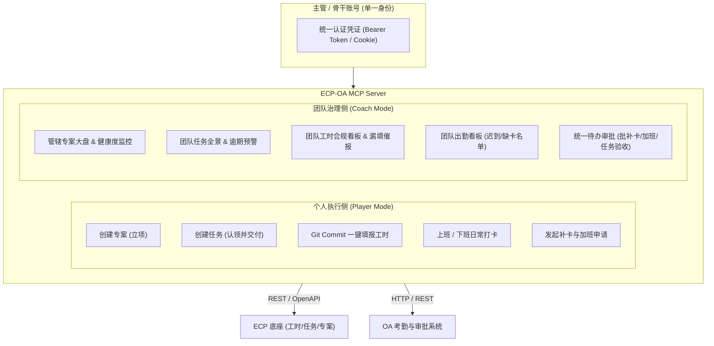

# ECP-OA MCP Server

基于 **Model Context Protocol (MCP)** 规范构建的企业效能与协同中枢服务，无缝打通 **ECP（企业中台 / AIPower / Quicksilver）** 与 **企业 OA 考勤系统**。

专为**“业务骨干兼团队管理者（Player-Coach / 运动员兼教练员）”**角色设计，支持个人日常产出执行与团队高效治理协同。

---

## 🌟 核心特性与双模架构

系统采用**“个人执行（Maker）与团队管理（Manager）”双轮驱动矩阵**，同一套主管账号身份无缝切换：



---

## 🛠️ MCP 工具清单 (Tools)

### 1. 工时管理 (Timesheet Tools)
* **`ecp_get_timereport_dashboard`**：获取个人指定日期的工时填报看板（目标工时、已填工时、明细与可选任务）。
* **`ecp_submit_timesheet`**：手工提交个人工时明细到 ECP 系统。
* **`ecp_auto_fill_timesheet_from_git`**：【一键填工时】扫描本地 Git 仓库当日 commits，智能生成工作描述并提交至 ECP。
* **`ecp_get_team_timesheet_summary`**：【主管管理】获取下属团队成员工时合规度概况（未填/少填名单）。
* **`ecp_remind_missing_timesheet`**：【主管管理】对未填或少填工时的成员发送一键催报提醒。

### 2. 考勤打卡与个人申请 (Clock & Attendance Tools)
* **`oa_get_clock_status`**：查询个人今日排班与考勤打卡状态。
* **`oa_punch_clock`**：执行上班打卡或下班打卡。
* **`oa_apply_clock_repair`**：【个人申请】因漏打卡等原因发起补卡申请，流转至直属上级。
* **`oa_apply_overtime`**：【个人申请】因工作需要发起加班申请，关联专案与工时。
* **`oa_list_my_applications`**：查询个人提交的审批单流转状态。
* **`oa_get_team_attendance_dashboard`**：【主管管理】查看团队今日考勤实况（正常、迟到、缺卡、请假）。

### 3. 专案管理 (Project Tools)
* **`ecp_create_project`**：创建新专案，默认将专案经理（PM）指定为您本人。
* **`ecp_list_my_managed_projects`**：【主管管理】查询我负责或管理的专案大盘（进度率、健康度、延期状态）。
* **`ecp_get_project_health`**：【主管管理】深度获取专案健康度、预算工时消耗比例与里程碑达成情况。

### 4. 任务管理 (Task Tools)
* **`ecp_create_task`**：创建新任务，支持指派给自己或分派给团队成员。
* **`ecp_update_my_task`**：更新个人名下任务进度，或申请完结验收。
* **`ecp_list_my_tasks`**：查询分配给当前用户的任务列表。
* **`ecp_list_team_tasks`**：【主管管理】查询团队全部任务，或管辖专案下的执行任务全景。
* **`ecp_audit_task_finish`**：【主管管理】验收下属申请完结的任务，通过归档，驳回打回修改。

### 5. 统一审核流程 (Unified Approval Tools)
* **`oa_list_pending_approvals`**：【主管管理】获取待我审批的流程单据池（补卡、加班、请假、任务验收、专案延期），内含 AI 辅助比对建议。
* **`oa_audit_action`**：【主管管理】执行单笔审批操作（通过或驳回）并写入审批批语。
* **`oa_batch_audit`**：【主管管理】对多笔经 AI 预检无异常的合规单据执行一键批量通过。

---

## 📦 MCP 上下文资源 (Resources)

* **`ecp://timereport/today`**：今日个人工时填报达成情况与明细快照。
* **`oa://clock/status`**：今日个人考勤打卡状态。
* **`ecp://tasks/my-pending`**：当前用户负责的进行中任务列表。
* **`oa://approvals/pending`**：当前待审批单据池快照。

---

## ⚙️ 快速安装与配置

### 1. 安装依赖与构建

```bash
cd ecp-oa-mcp
npm install
npm run build
```

### 2. 配置环境变量

复制 `.env.example` 为 `.env` 并填写相关账号配置：

```env
ECP_BASE_URL=https://econtact.gemfor.com.tw/ecp
ECP_USERNAME=your_username
ECP_PASSWORD=your_password
ECP_AUTH_TOKEN=your_token

OA_BASE_URL=http://localhost:12822
OA_AUTH_TOKEN=your_token

# 配置本地 Git 项目路径（用于一键从 Commit 填报工时）
GIT_PROJECTS=springcloud-aile=E:\develop\project\springcloud-aile;AuthServer=E:\develop\project\AuthServer\authserver
DEFAULT_DAILY_HOURS=8.0
```

### 3. 接入 MCP Client (Cursor / Claude Desktop / Antigravity)

在您的 MCP Client 配置文件中添加：

```json
{
  "mcpServers": {
    "ecp-oa-mcp": {
      "command": "node",
      "args": ["E:\\develop\\project\\ecp-oa-mcp\\dist\\index.js"],
      "env": {
        "ECP_BASE_URL": "https://econtact.gemfor.com.tw/ecp",
        "ECP_USERNAME": "your_username",
        "ECP_PASSWORD": "your_password"
      }
    }
  }
}
```

---

## 💬 典型对话场景

* **早上开工**：*“帮我上班打卡，看下今天团队出勤和我的紧急任务。”*
* **白天派活**：*“在【AIPower 重构】专案下建一个任务：让张三在本周五前完成接口联调，预估 16 小时。”*
* **午间审批**：*“查一下待我审批的事项，如果张三的补卡时间和李四的加班申请符合 Git 记录，帮我批量通过。”*
* **晚上收尾**：*“今天加班到 20:30，帮我提一个 2.5 小时加班单；然后根据今天的 Git Commit 填满 10.5 小时工时，最后下班打卡。”*

---

## 📄 License
MIT License
